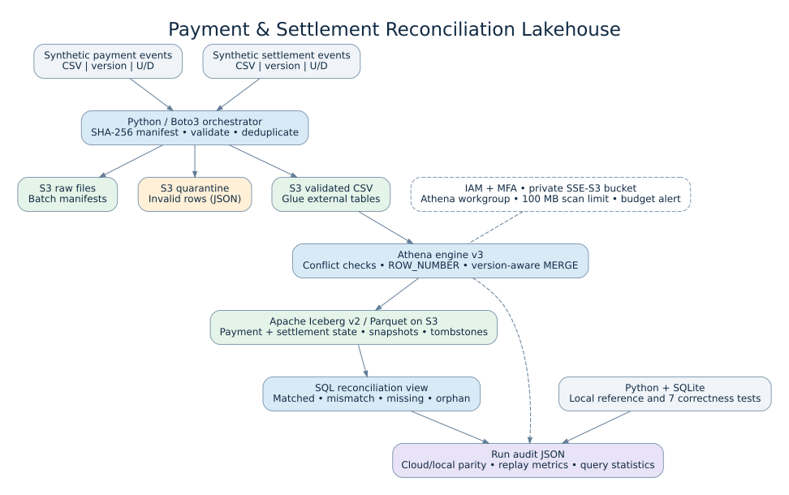
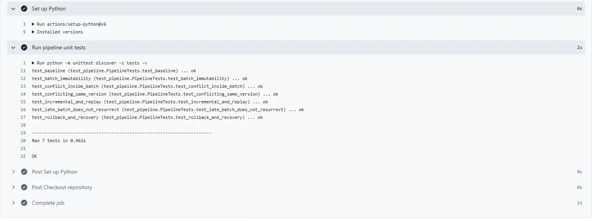
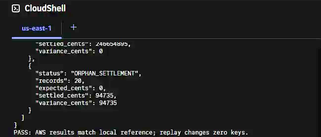
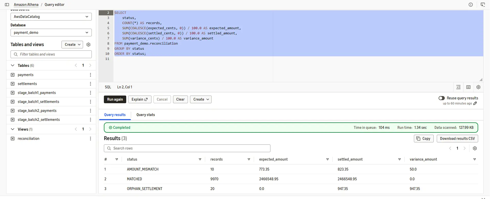
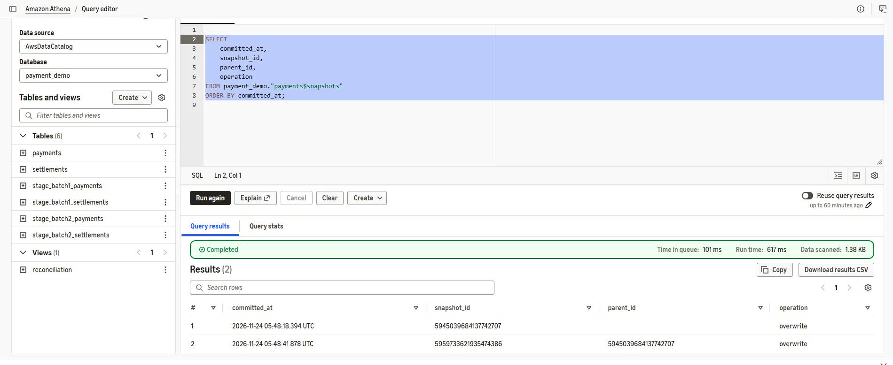
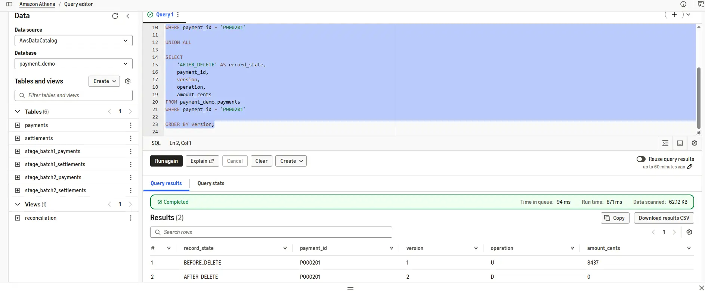

# Payment & Settlement Reconciliation Lakehouse

[](https://github.com/GITHUBKNS/aws-payment-reconciliation-lakehouse/actions/workflows/tests.yml)


A hands-on portfolio project: versioned change events from a synthetic retailer's payment ledger and settlement processor, reconciled with SQL. The local reference implementation uses Python and SQLite; the cloud deployment uses Amazon S3, Athena engine v3, the Glue Data Catalog and Apache Iceberg v2. **Status: Successfully deployed and validated on AWS on November 24, 2026.** Seven local correctness tests passed on Windows and AWS CloudShell; all 31 Athena statements in the deployment audit succeeded. No real card data, PHI, PII or employer information is used.

## Architecture




Events are **simulated CDC exports**, not a live database log capture. Each event contains a payment ID, monotonically increasing source version, operation U (upsert) or D (delete/tombstone), and an integer amount in cents. Each settlement is a single net settlement per payment in this simplified model. Payment and settlement versions are independently maintained. Refunds are represented as a new net amount, not separate ledger entries. The pipeline never uses floating-point money. A delete retains the latest version to prevent a delayed older event from resurrecting a record.

## Run locally (Python 3.10+; no dependencies)

Extract the ZIP and open a terminal in the folder containing this README:

```sh
python -m unittest discover -s tests -v
python src/pipeline.py
```

On Windows use `py` instead of `python` if necessary. The runner generates the files in `data/`, applies batch1, batch2 and replays batch2, then writes `output/demo.db` and `output/reconciliation_summary.json`. Use a fresh database for the baseline demonstration (`python src/pipeline.py --db output/fresh.db`). The existing database can also be replayed; it will retain newer state. Do not delete any unrelated local databases.

| Status | Initial | After incremental batch | Replay |
|---|---:|---:|---:|
| MATCHED | 9,980 | 9,970 | 9,970 |
| MISSING_SETTLEMENT | 10 | 0 | 0 |
| AMOUNT_MISMATCH | 10 | 10 | 10 |
| ORPHAN_SETTLEMENT | 10 | 20 | 20 |

20,247 raw rows across two distinct batches; 240 changed keys in batch2; zero on replay. Two malformed records in batch2 are quarantined; exact duplicates and superseded versions are counted separately. These are deterministic synthetic correctness tests, not a performance benchmark. A matched transaction count is not a count of all historical events.


## Automated Testing and Continuous Integration

The project includes seven automated unit tests covering baseline processing, incremental updates, idempotent replay, batch immutability, conflicting same-version records, late-arriving event protection, and transaction rollback and recovery.

All seven tests passed successfully across three execution environments:

- Windows — local development and validation
- AWS CloudShell — Linux-based validation
- GitHub Actions — automated continuous integration

The GitHub Actions workflow runs the test suite on pushes and pull requests to the `main` branch and also supports manual execution. The verified hosted CI run completed all seven tests in 0.962 seconds with zero failures.

The CI workflow does not require AWS credentials or provision cloud resources.

### GitHub Actions Execution Evidence



[View GitHub Actions workflow runs](https://github.com/GITHUBKNS/aws-payment-reconciliation-lakehouse/actions)

[View local pipeline reference results](docs/local_results.txt)

## AWS implementation

Follow [AWS setup and deployment](docs/aws_setup.md). The runner uploads original and validated data, creates Iceberg tables and staging metadata, executes SQL MERGE, compares the cloud results and change counts against the local reference, and writes a query-level audit report. AWS Glue is used as a catalog only, not as a Spark processing service. The AWS path requires a real AWS account. The recorded deployment in us-east-1 succeeded under a dedicated IAM user using a private SSE-S3 bucket and an Athena SQL workgroup with a 100 MB per-query scan limit. See [measured execution results](docs/results.md), [sanitized query audit](docs/aws_execution_audit.json), and [verification SQL](sql/verify.sql). The runner source is preserved as tested; its original help text predates the live validation.

## Observed AWS results

| Metric | Result |
|---|---:|
| Input events across distinct batches | 20,247 |
| Incremental changed keys (both streams) | 240 |
| Replay changed keys | 0 |
| SQL statements succeeded | 31/31 |
| Transactional MERGE statements | 6 |
| Data scanned (deployment only) | 1,521,833 bytes |
| Cumulative engine execution time | 30.109 s |
| Matched synthetic payments | 9,970 |
| Net reconciliation variance | $997.35 |

The two final summaries matched the SQLite reference. An independent Athena query returned the same reconciliation totals; Iceberg version travel retrieved payment P000201 before and after its logical deletion. These are small-fixture observations, not production throughput benchmarks. See [results and cost assumptions](docs/results.md).

## Live AWS Execution Evidence

### Successful AWS Deployment



### Financial Reconciliation



### Apache Iceberg Snapshot History



### Iceberg Time Travel and Tombstone Verification



[View all execution evidence](docs/screenshots/)

## Important engineering decisions

- Version guard: update only when the incoming version is greater than the stored version; retain tombstones.
- Same-key same-version contradictory events fail closed within a batch or when matching current state. Historical conflicts for versions older than current state are not detected; a full event-history ledger would solve that.
- Raw files and SHA256 batch manifest preserve replay identity; use a single writer, dedicated S3 prefix and database. For actual immutable archival, add S3 Object Lock/versioning and tighter permissions.
- Local updates across both state tables are transactional in SQLite. Athena MERGE transactions are per Iceberg table, not cross-table: a partial cloud failure requires replay; do not serve reconciliation as finalized while a run is incomplete.
- Reconciliation is a query-time view, not an incrementally materialized Gold table. Missing settlements may be normal before a settlement SLA expires; production classification needs event timestamps, currency, cutoffs and settlement windows.
- This is a small lab: Python validation loads one batch in memory. Production would use Glue/Spark distributed validation and CDC ingestion, robust schema contracts, partitioning/compaction, monitoring/alerts, restricted IAM and workflow scheduling. No AWS Glue Spark, DMS, Kafka, Step Functions or BI deployment is claimed.

## References
- [Athena Iceberg CREATE TABLE](https://docs.aws.amazon.com/athena/latest/ug/querying-iceberg-creating-tables.html)
- [Athena MERGE INTO](https://docs.aws.amazon.com/athena/latest/ug/merge-into-statement.html)
- [AWS Glue Iceberg integration](https://docs.aws.amazon.com/glue/latest/dg/aws-glue-programming-etl-format-iceberg.html)
- [AWS Free Tier supported services](https://docs.aws.amazon.com/accounts/latest/reference/supported-services-sign-up-new.html)
